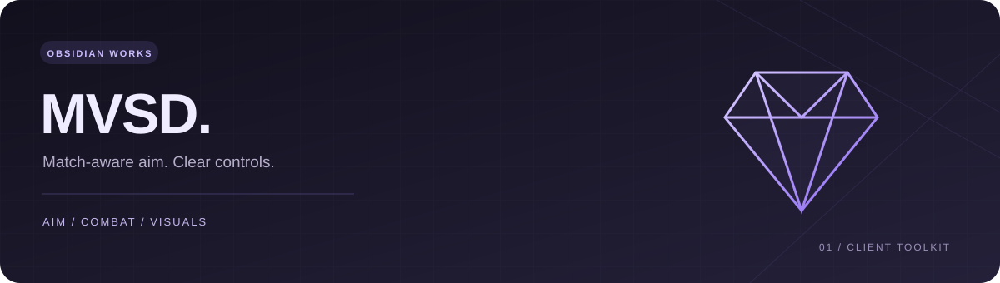

<p align="center"></p>

# Obsidian Works · MVSD

A toolkit for **Murderers vs Sheriffs Duels**, with ten searchable tabs and 68 settings.

```lua
loadstring(game:HttpGet("https://github.com/ObsidianWorkss/MVSD/releases/latest/download/loader.lua"))()
```

**Right Shift** toggles the menu unless your saved profile uses another key. There is one **Current build** release, updated in place. Gameplay assistance starts off in a new profile; settings then save/load on the same executor workspace.

| Area | Controls |
| --- | --- |
| Aim assistance | Hold/always modes, instant alignment or smoothing, automatic visible body points, FOV/priority, dual-origin line checks, team/match/protection checks, per-frame target refresh, reachable knife prediction |
| Combat | Experimental assisted gun-shot hotkey, crosshair trigger, tool cooldown margin, weapon auto-equip and status |
| Visuals | Opponent/ally highlights, names, roles, health, distances, screen boxes, tracers, match-only filters and proximity alerts |
| Movement | Absolute speed target, jump strength, repeated ground jumping |
| Camera/graphics | FOV, zoom, fullbright, fog, shadows, particles, post effects and materials |
| Session/settings | HUD, speed/cooldown diagnostics, local spectating, recognized music mute, anti-idle, themes, hotkeys and profile backups |

In the lobby, use **Preview lobby visuals** to inspect the display. Match-only aim excludes lobby players by default. Assisted shots require an equipped gun and a valid opponent in your active match, with normal cooldown and actual raycast hits. Server acceptance of assisted shots has not been demonstrated; sending a request is not confirmation of a hit.

Choose **Overview → Accuracy preset**, hide the menu, and hold your aim key (right mouse by default). It enables instant alignment, automatic visible torso/head selection and knife interception checks. Assisted shots and crosshair triggering remain separate options. Trigger positions and body visibility are checked again at request time. Movement after observation, cover and network/server behavior can still cause misses; this is not guaranteed-hit functionality.

This repository contains only the encoded build, loader and required notices. Source and development history remain private. Client-side encoding remains reversible and is not a guarantee against reverse engineering.

UI powered by [WindUI](https://github.com/Footagesus/WindUI), with its MIT notice in [licenses/WindUI.LICENSE](licenses/WindUI.LICENSE).
